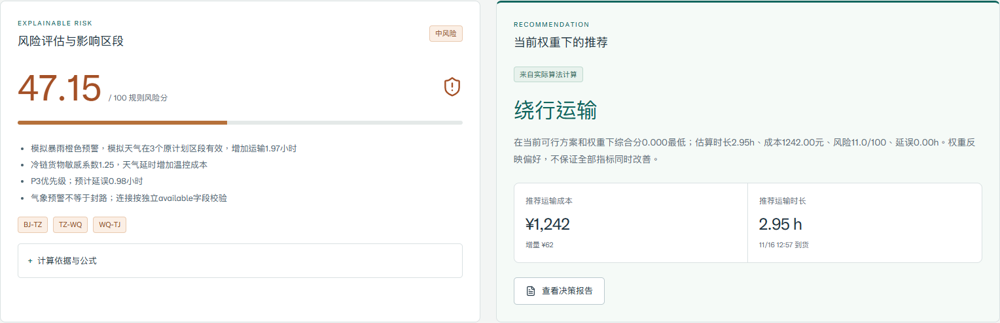
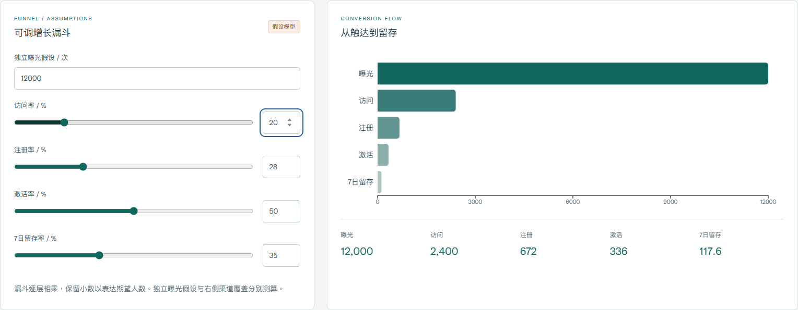

# SkyRoute AI · 天气智运与增长决策平台

北京物资学院《人工智能导论》课程与DataClawHub校园赛双赛题作品。项目将增长运营实验和气象物流决策放进可解释、可复现的本地工作台，提供网站源码、Windows独立桌面程序、赛事视频与课堂展示材料。

原仓库背景“大一·人工智能导论”保留。项目没有虚构真实学生分工、推广业绩或实测运输收益。

## 下载与运行

打开[正式发布页](https://github.com/DJC-I/End-ClassWork-I/releases/tag/v1.0.0)。

|文件|用途|
|---|---|
|SkyRoute-AI-v1.0.0-Windows-x64.exe|Windows x64独立程序，双击启动，无需另装Python或Node|
|校园赛正式提交材料.zip|两份Word与两条1080p中文女声参赛视频|
|课堂展示材料.zip|12页PPT、单人演讲稿、15问答辩及演示指南|
|完整交付包.zip|上述全部材料、桌面程序、技术文档、验收与校验|
|SHA256SUMS.txt|四个主要下载资产的SHA-256|

系统要求：64位Windows 10/11，推荐1440×900及以上显示器，约1GB可用磁盘空间。最终程序未进行商业代码签名，系统可能显示SmartScreen信誉提醒；无需关闭Defender或其他安全功能。没有安装器，不写入系统服务。

第一次启动自动建立`%LOCALAPPDATA%/SkyRouteAI/skyroute.db`，关闭再启动保留订单和参数。课堂页可明确确认后重置教学数据。移动EXE不影响同一用户的数据目录。窗口关闭时关联服务退出。核心演示离线运行；桌面正式版默认仅规则模式，不读取开发者`.env`，不会内置API密钥。

## 两个赛题与真实能力

- **DataClawHub平台运营方案**：4类用户画像、6类运营策略、可调漏斗、5渠道预算与CAC、A/B双侧两比例检验及样本提示、任务CRUD与持久化、运营报告。
- **气象物流AI风险决策系统**：运输订单CRUD、原子JSON导入和CSV导出、7节点10有向连接、3种天气、逐单风险、四类方案、权重推荐、6步实际工具轨迹、配对情景仿真及可下载决策报告。
- **课堂演示**：双赛题快捷入口、计时、全屏、教学重置、来源与算法说明。




## 架构与页面

React 19 / TypeScript / Vite / Recharts / Lucide → 同源FastAPI / Pydantic → SQLite。风险、图搜索、加权推荐与统计运算在Python后端执行；可选模型只解释已经算出的数字。Electron内置Chromium，PyInstaller封装独立后端，portable EXE运行时解压必要资源。

|路径|内容|
|---|---|
|`/`|总览门户|
|`/growth`|增长运营工作台|
|`/logistics`|气象物流决策|
|`/demo`|课堂展示控制台|
|`/about`|技术、数据与方法边界|

全站采用纸白、墨蓝与蓝绿色的运行决策工作室设计。用户提供字体已实际加载，并明确授权随源码和EXE公开再分发。没有恢复已删除的官方核实卡片或过时阶段提示。

## 从源码启动

开发环境需要Python 3.12、Node.js 22.12或以上、npm。首次安装依赖需要网络。

```powershell
git clone https://github.com/DJC-I/End-ClassWork-I.git
cd End-ClassWork-I/project
python scripts/start.py
```

也可双击`project/start.cmd`。浏览器访问`http://127.0.0.1:8000`；端口占用时用`python scripts/start.py --port 8001`。依赖与前端已经就绪后，`python scripts/start.py --no-build`可离线启动。网站源码版提供`/docs`；桌面程序关闭调试文档，只监听随机本机端口并要求每次启动的随机会话头。

可选外部模型仅用于**源码网站版**：将`project/.env.example`复制为`.env`，配置`OPENAI_API_KEY`、`OPENAI_BASE_URL`和`OPENAI_MODEL`后重启。只有“生成分析解释”发送当前模拟订单、天气和算法快照到指定供应商；核心运算不调用模型。真实供应商调用未验证，异常自动降级规则解释。不要提交`.env`。

## 构建与复验

```powershell
cd project
python -m venv .venv
.venv/Scripts/python.exe -m pip install -r backend/requirements.lock.txt
.venv/Scripts/python.exe -m pytest tests -q
cd frontend
npm ci
npm run typecheck
npm run build
cd ..
powershell -ExecutionPolicy Bypass -File scripts/build_windows.ps1
node scripts/test_desktop_phase5.cjs
```

桌面构建仅适用于Windows x64，锁定Electron、electron-builder和PyInstaller版本；首次需下载构建工具。源码脚本和测试用独立数据库；不要对个人录入库执行演示重置。历史材料生成脚本作为溯源保留，涉及可移植LibreOffice、FFmpeg与文档工具的部分需要另行配置，不是运行应用的依赖。

`.github/workflows/release.yml`支持手动构建及`v*`标签；普通push不会发布Release。已有正式资产不会自动覆盖。CI生成的独立构建保留自己的校验和，不声称与本机打包字节完全相同。

## 数据真实性与边界

全部物流订单、网络、道路里程、运力、费用、天气和增长参数均为**教学模拟**。拓扑连线不是导航道路；天气预警不等于封路或停运。风险分是规则量表，不是事故概率。仿真是订单在0.85/1/1.15严重度下的固定压力回放，不是真实准时率预测或历史实绩。运营预算和效果均是假设，没有真实投放或D7留存成绩。

时间统一UTC+8、教学基准日2026-11-16。种子来自`project/backend/seed.py`；JSON仅为参考快照。默认暴雨SR-001风险47.15，推荐绕行1242元、2.95小时；改动订单、权重或天气后重新计算。六步轨迹为真实工具调用，规则模式明确标注，不伪装成实时大模型推理。

没有真实天气接口、实时GPS、共享车队容量调度或业务收益验证。赛事工具包网络资源未取得，未伪称使用官方路网；报名资格与实际提交须参赛者按官方要求确认。项目未代为报名。

## 材料、隐私与许可证

最新版视频170/175秒、1920×1080，保留第4.5阶段自然中文合成女声音轨及新版真实界面。PPT12页，单人逐页讲稿6分钟排期；约5分46秒为语速估计，非本人彩排。原始私有文件与本地历史保留在开发环境，公开副本用相对路径；PPT署名Dux由用户明确批准。公开源码从远端既有初始提交继续，不发布含私人路径的旧本地历史。

见[隐私审查](PRIVACY_REVIEW.md)、[发布说明](RELEASE_NOTES.md)、[第三方资源](THIRD_PARTY_NOTICES.md)、[架构](project/ARCHITECTURE.md)和[设计系统](project/docs/PHASE4_6_DESIGN.md)。第三方组件保留各自许可；用户字体未附上游完整许可证，本次公开分发依据用户对其再分发权的明确确认，不将其视为项目代码许可。项目原创代码未额外授予统一开源许可证，其他使用方式需遵守相应权利人的许可。

已验证范围与限制以第五阶段验收报告为准。没有把自动检查表述为穷尽安全证明，也没有声称完成真人逐字听审、教室设备验证、所有Windows版本兼容或所有视频帧的OCR。

## 正式发布验收

v1.0.0已正式发布，五项资产已实际下载并逐项核对SHA-256。GitHub会移除资产中文名称，因此三个ZIP下载名分别使用Campus-Submission、Classroom-Presentation、Full-Delivery，显示标签及包内名称保持中文。

[最终发布报告](project/docs/phase5/FINAL_RELEASE_REPORT.md)记录实际测试、下载校验及未验证范围。正式标签指向验收源码，main上的后续文档提交仅补记发布结果，不移动v1.0.0。
